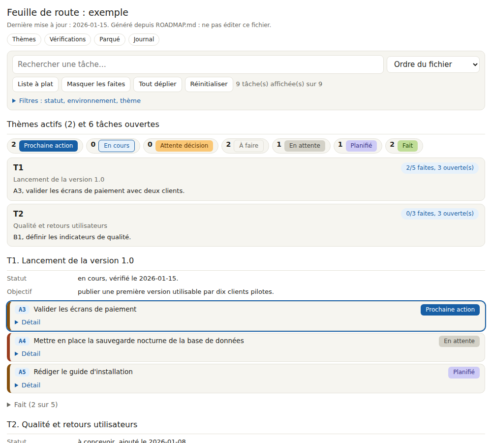
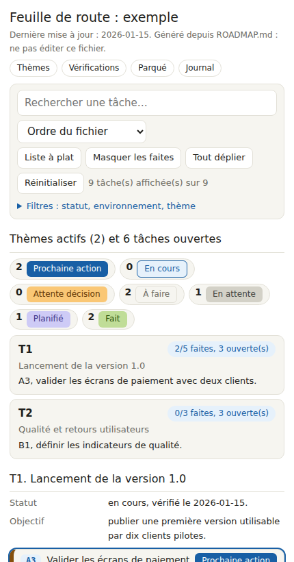

# Feuille de route

Une feuille de route écrite en Markdown, affichée comme une liste de tâches interactive : thèmes, tâches ouvertes puis faites, statut et environnement de chaque tâche, recherche, filtres, tri, détail et historique tirés du journal.





## Utilisation
```bash
python3 gen_roadmap_html.py ROADMAP.md docs/index.html
```
Le script écrit deux fichiers : la page complète (`docs/index.html`, à publier avec GitHub Pages, branche `main`, dossier `/docs`) et `docs/index.artifact.html`, le contenu seul, prêt à être publié comme artefact dans Claude Desktop (deux thèmes clair et sombre, largeur de panneau). Aucune dépendance : Python 3 seulement.

Option `--launch="/commande {id}"` : chaque tâche ouverte reçoit un bouton « Lancer » qui envoie la commande à Claude, avec l'identifiant de la tâche. L'artefact doit alors déclarer la capacité `comments` à la publication. Sans l'option, aucun bouton.

## Format de ROADMAP.md
- `# Titre`, puis `Dernière mise à jour : AAAA-MM-JJ.`
- `## Thèmes actifs`, avec un `### T1. Titre` par thème : lignes `Statut :`, `Objectif :`, `Prochaine action :`, `Bloqueur :` (et `Fait :` si utile), puis les tâches.
- Tâche ouverte : `- [ ] A3 Titre : détail`. Tâche faite : `- [x] A1 Titre : détail. Fait le 2026-01-05.` Les tâches ouvertes se placent avant les faites.
- `## Vérifications du lendemain (date)` : tâches à contrôler, même format.
- `## Parqué` : une puce par élément. `## Journal` : une ligne par date, la plus récente en premier, `- AAAA-MM-JJ : A3 ce qui s'est passé` ; les lignes qui commencent par l'identifiant d'une tâche deviennent son historique.

## Statuts (déduits du texte)
Fait (tâche cochée), Prochaine action (première tâche ouverte du thème), En cours (« fait le AAAA-MM-JJ » dans le texte), Attente décision (« à valider », « sur confirmation »), En attente (« dépend de », « attend … »), Planifié (« à partir du AAAA-MM-JJ »), À faire. Les règles sont dans `status_of`.

## Environnements
Chaque tâche reçoit jusqu'à trois étiquettes de couleur d'après des mots-clés (liste `ENVS` en haut du script : sécurité, infra, code, automatisation, communication, données, produit, exploitation). Adaptez les noms et les expressions à votre projet.

## Réalisation
L'intégralité de ce projet (script, page, exemple, README) a été réalisée avec Claude Code, et la page est publiée comme artefact dans Claude Desktop.

## Licence
MIT, voir `LICENSE`.
